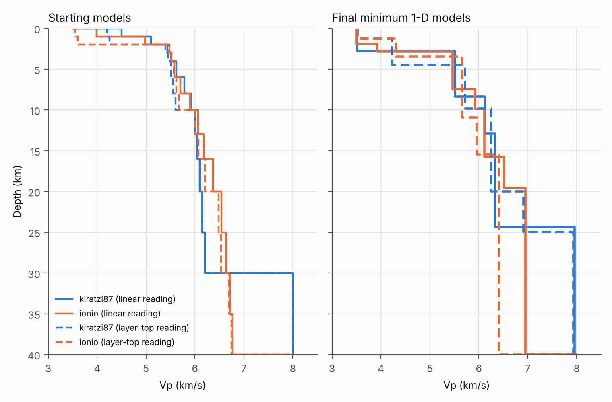
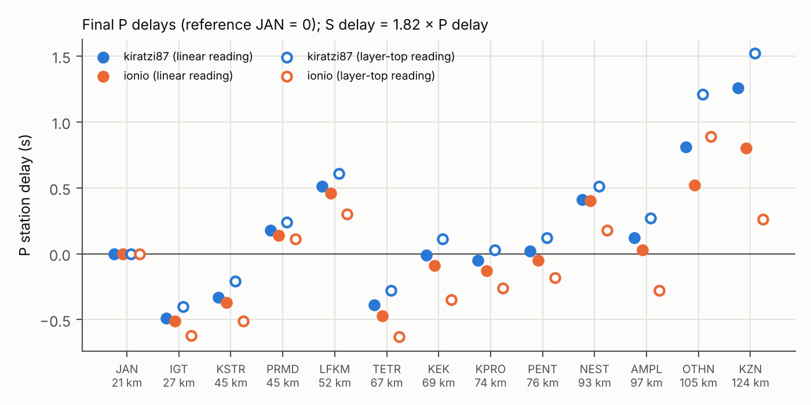
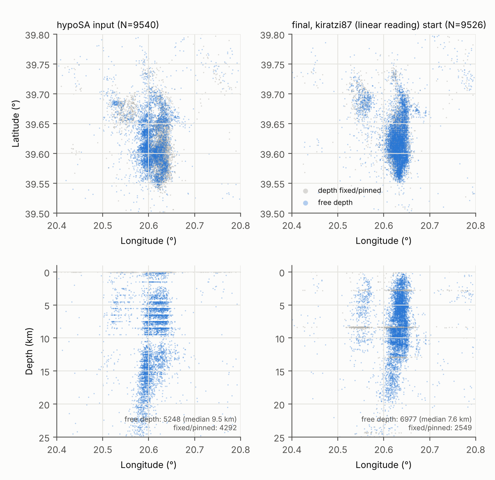

# PyVelest for the Ioannina 2026 sequence (PhaseNet → REAL → hypoSA input)

This branch adapts PyVelest to your data and runs it. It contains:

* **Input converters:** your REAL/hypoSA files → `inputs/catalog.pha` + `inputs/stations.csv`; your TauP models
  `kiratzi87.nd` / `ionio.nd` → VELEST starting models.
* **Pipeline fixes:** several of them change results, including bugs that were already in the original code
  (see [§7](#7-what-changed-in-the-code)).
* **Results:** a minimum 1-D model, station delays and relocations for the target area 39.5–39.8°N /
  20.4–20.8°E, from **four starting models**, in `results/ioannina/`.

Every number below comes from the full runs in `results/ioannina/*/summary.json`. Those runs predate the
recipe's stage 1 (§4): they used damping 1.0 / 0.1 with 8 iterations, and every stage-1 run restarted
from the catalogue hypocentres with zero station delays. Rerun them to update the numbers.

---

## 1. Quick start

```sh
# VELEST: build the double-precision executable PyVelest uses by default (GLOBAL_SETTINGS.velest_exec)
sh src/exc/build_velest.sh                      # -> src/exc/velest_gfortran

# Inputs (already committed; rebuild only if the REAL/hypoSA files change)
python tools/prepare_real_inputs.py \
    --stations "inputs/My inputs/ioannina/ioan_stations.dat" \
    --phases "inputs/My inputs/ioannina_final.txt" \
    --sa-catalog "inputs/My inputs/ioannina/catalogSA_allday.txt" \
    --sa-phases "inputs/My inputs/ioannina/phaseSA_allday_kiratzi87.txt"

# Starting models (already committed). Layer-top versions: add --interp step, --name KIRATZI87_STEP /
# IONIO_STEP and --out inputs/vmodel_kiratzi87_step.dat / inputs/vmodel_ionio_step.dat
python tools/nd_to_velest.py "inputs/My inputs/kiratzi87.nd" --tops -3 0 1 2 3 4 6 8 10 13 16 20 25 \
    --moho 30 --vtop 3.5 --min-increment 0.05 --name KIRATZI87_LINEAR --out inputs/vmodel_kiratzi87.dat
python tools/nd_to_velest.py "inputs/My inputs/ionio.nd" --tops -3 0 1 2 3 4 6 8 10 13 16 20 25 30 35 \
    --moho 40 --vtop 3.5 --min-increment 0.05 --name IONIO_LINEAR --out inputs/vmodel_ionio.dat

# Run: one config per copy of the repository (all configs write to outputs/ and figures/)
python pyvelest.py                                    # configs/user.yaml  (kiratzi87 start)
python pyvelest.py --config configs/user_ionio.yaml   # ionio start
#   layer-top starts: in a further copy set INPUTS.vmodel to inputs/vmodel_kiratzi87_step.dat
#   (user.yaml) or inputs/vmodel_ionio_step.dat (user_ionio.yaml)
python pyvelest.py --stages 5                         # redo single stages; earlier outputs are kept
```

A full run is 5 × 50 + 5 × 25 = 375 VELEST inversions of 500 events. An inversion of 8 iterations takes
about 9 s. Stage 1 now allows up to 24 iterations (§4), so a full run takes up to about 2.5 h with
`n_jobs: 1` and about 40 min with `n_jobs: 4`. `--stages 2..5` needs the
earlier stages of the same run in `outputs/` (the `outputs/` committed in the repository is the original
example run). The final products land in
`outputs/stage_fn/`:

* `model.mod` / `model.csv`: the minimum 1-D model (`model.csv` includes the Vs that was used).
* `stations.sta` / `stations.csv`: station delays; P delays plus the S delay that was applied.
* `relocated.csv`: phase-level relocations.
* `events.csv`: one row per event, with quality flags.

---

## 2. Inputs and how they were built

| File | Built from | Notes |
|---|---|---|
| `inputs/stations.csv` | `ioan_stations.dat` | 16 stations, elevation km → m. Only 13 have picks; KBN, LSK and SRN have none. |
| `inputs/catalog.pha` | hypoSA hypocentres and origin times (`catalogSA_allday.txt`) + picks and PhaseNet probabilities (`ioannina_final.txt`) | Events are matched by order and checked against `phaseSA_allday_kiratzi87.txt`. Travel times are re-referenced to the hypoSA origin (they match hypoSA's to 1 ms). The hypoSA residual goes into the header's RMS field. Magnitudes come from `ioannina_final.txt`; its picks are identical to `phase_allday.txt`. |
| `inputs/vmodel_*.dat` | `kiratzi87.nd`, `ionio.nd` | See §3. |

Facts about the data that drive the settings:

* **Catalogue size:** 10,362 events and 130,843 picks (69,153 P / 61,690 S). 9,540 events (92 %) lie in
  the target box.
* **Network geometry:** no station lies inside the target box. The nearest are JAN (~21 km) and IGT
  (~26 km), the farthest with picks is KZN (~124 km). Depth resolution is the weak point (§6).
* **Pinned depths:** **hypoSA pins 44 % of the events at exactly 0 km.** These events are left out of the
  stage-1 event selection. In stages 2 and 5 VELEST starts them at 10 km
  (`INPUTS.unconstrained_depth_below_km` / `start_depth_km`), because a relocation started at the free
  surface stays there.
* **Pick weights:** PhaseNet probabilities become VELEST weight classes (`PICK_WEIGHTS`):

  | probability | ≥ 0.85 | 0.70–0.85 | 0.55–0.70 | 0.40–0.55 | < 0.40 |
  |---|---|---|---|---|---|
  | VELEST class | 0 | 1 | 2 | 3 | 4 (not used in inversions) |
  | share of P picks | 43 % | 22 % | 15 % | 13 % | 7 % |
  | share of S picks | 6 % | 24 % | 30 % | 24 % | 15 % |

* **Vp/Vs = 1.82**, from a Wadati fit of 27,432 P–S pairs in the box: (ts − tp) against tp with a free
  intercept, using P picks with probability ≥ 0.70 and S picks with probability ≥ 0.55. The median of the
  per-event slopes is 1.83. Without the probability filter, the estimate ranges from 1.79 to 1.84
  depending on the fit.
  VELEST uses the S picks with this fixed ratio (`phase_mode: 3`), so the S delay of each station is
  1.82 × its P delay.

---

## 3. Starting models

TauP `.nd` files are interpolated **linearly** between the listed depths; a jump needs two rows at the
same depth. `kiratzi87.nd` and `ionio.nd` list their crust as single rows. TauP (and REAL's travel-time
tables) therefore see them as **gradient** models, even if they were meant as layer tops. I built both
readings:

* `linear` = TauP semantics (the default of `tools/nd_to_velest.py`);
* `step` = each row is the top of a constant-velocity layer.

That gives four starting models.

Common choices:

* **Top layer:** −3 to 0 km at 3.5 km/s in all four models. It only covers station elevations (up to
  1.13 km), it is heavily damped and it is never merged. When it differed between models it acted as a
  different velocity floor in each, because low-velocity layers are not allowed.
* **Layering:** 1–2 km layers in the upper crust, 3–5 km deeper.
* **Velocity steps:** every step is at least 0.05 km/s (0.04 once in `vmodel_ionio.dat`, after rounding
  to two decimals). This keeps the mean of PyVelest's random models within ~0.06 km/s of the starting
  model. As a consequence the flat 6.0 km/s section of kiratzi87 (10–30 km) starts at 6.00–6.20.
* **Moho:** at 30 km (kiratzi87) / 40 km (ionio), with 8.0 km/s below. Your files put the first
  "mantle" row at 70 km, which a TauP reader turns into a 6→8 km/s gradient; that cannot be expressed in
  VELEST, and this geometry does not resolve it anyway (§6).



---

## 4. Pipeline settings for this dataset

| Stage | What runs | Key settings |
|---|---|---|
| 1 | 5 runs × 50 simultaneous inversions from perturbed starting models (VELEST recipe, step 2). Each run starts from the previous run's merged average model, averaged station delays and median relocated hypocentres | Events: box, depth > 0.1 km, ≥ 8 stations with usable picks, gap ≤ 180° (usable stations), hypoSA RMS ≤ 0.5 s → 739 candidates → 500 spread over a 6×6×6 grid. Damping as in the recipe: 0.01 (hypocentres), 0.01 (station delays), 0.1 (velocity); up to 24 iterations. Reference station: JAN (highest score) |
| 2 | Single-event relocation of all 10,362 events with the stage-1 model and delays, then reselection | `RESELECTION`: erh ≤ 4 km, 0.5 ≤ erz ≤ 4.5 km, RMS ≤ 0.3 s → 1,375–1,555 candidates → 500 |
| 3 | 5 runs × 25 inversions on the reselected events (recipe step 4); each run's model seeds the next, hypocentres and station delays come from stage 2 | Damping 0.01 (hypocentres), 0.1 (station delays), 1.0 (velocity); 8 iterations |
| 4 | Stability test: unperturbed reference inversion (`run_00`), then 5 inversions with hypocentres shifted N(0, 5 km) in x, y and z | Final positions are compared with `run_00` |
| 5 | Final single-event relocation of all events with the final model and delays → `outputs/stage_fn` | Station delays are used (`use_station_corrections: true`) |

Other settings, in all stages:

* VELEST coordinate origin: 39.65°N 20.60°E; VELEST counts East longitudes as negative, so `olon` = −20.60.
* Maximum epicentral distance: 150 km.
* `phase_mode: 3`, Vp/Vs 1.82.

### 4.1 High-quality event selection

`configs/user_hq500.yaml` and `configs/user_hq1000.yaml` (kiratzi87 start) choose events by the quality of
their P arrivals instead of the standard limits:

```sh
python pyvelest.py --config configs/user_hq500.yaml    # >= 8 high-quality P stations, P gap <= 150 deg
python pyvelest.py --config configs/user_hq1000.yaml   # >= 7 high-quality P stations, P gap <= 150 deg
```

To start from ionio, set `INPUTS.vmodel: inputs/vmodel_ionio.dat`. Run each config in its own copy of the
repository.

**Settings in `EVENT_SELECTION`**

| key | meaning |
|---|---|
| `hq_p_max_class: 1` | a high-quality P pick has weight class ≤ 1, i.e. PhaseNet probability ≥ 0.70 |
| `min_hq_p_stations` | minimum number of stations with a high-quality P pick (`n_hq_p`) |
| `max_hq_p_gap_deg` | maximum azimuthal gap of those stations (`gap_hq_p`) |
| `rank_by: ["-n_hq_p", "gap_hq_p", "rms"]` | preference order; a `-` prefix means descending |
| `spatial_balance` | `true`: take the best events from each cell of the 3-D grid in turn; `false`: take the top `max_events` overall |
| `include_unconstrained_depths: true` | keep the events hypoSA pinned at 0 km and select them as if at `start_depth_km` |

**Event counts in the target box**

* **Stage 1:** 601 events pass the 500-event limits and 1,028 pass the 1,000-event limits.
* **Pinned events:** about two thirds of these high-quality events were pinned at 0 km by hypoSA, so the
  standard selection would drop them. That is why `include_unconstrained_depths` is on.
* **RMS limit:** the hypoSA RMS of these events is high (median about 0.5 s), so stage 1 only removes
  outliers above 0.8 s.
* **Stage-2 reselection:** the same high-quality limits are applied to VELEST's relocations, together with
  RMS ≤ 0.3 s and erz ≥ 0.5 km. VELEST's formal erh/erz limits are not used. With the stage-1 model of the
  standard run, about 550 and 950 events pass.

`events.csv` also carries `n_p`, `n_s`, `n_hq_p` and `gap_hq_p`, so the final relocations can be filtered
the same way.

**Run time.** One inversion with 1,000 events takes about five times as long as with 500 (about 55 s
against 9 s), because VELEST's matrix grows with the square of the number of events. A full 1,000-event
run is about 5.5 CPU-hours, or about 1.5 hours with `n_jobs: 4`.

---

## 5. Results

### 5.1 Velocity model

All 375 inversions of every run converged (5 × 50 in stage 1, 5 × 25 in stage 3). Final models (Vp in
km/s at each depth):

| depth (km) | kiratzi87 linear | ionio linear | kiratzi87 layer-top | ionio layer-top | spread |
|---|---|---|---|---|---|
| 0.5 | 3.51 | 3.50 | 3.52 | 3.51 | 0.02 |
| 1.5 | 3.51 | 3.50 | 4.23 | 4.30 | 0.80 |
| 2.5 | 3.51 | 3.92 | 4.23 | 4.30 | 0.79 |
| 3.5 | 5.51 | 5.46 | 4.23 | 5.66 | 1.43 |
| 5–7 | 5.51 | 5.46 | 5.72 | 5.66 | 0.26 |
| 9 | 6.12 | 5.92 | 5.72 | 5.66 | 0.46 |
| 11 | 6.12 | 6.11 | 6.25 | 5.96 | 0.29 |
| 13–15 | 6.33 | 6.11 | 6.25 | 5.96 | 0.37 |
| 18 | 6.33 | 6.52 | 6.25 | 6.41 | 0.27 |
| 22 | 6.33 | 6.95 | 6.91 | 6.41 | 0.62 |
| 27+ | 7.96 | 6.95 | 7.93 | 6.41 | 1.55 |
| **final RMS (stage 3)** | **0.125 s** | 0.130 s | 0.137 s | 0.128 s | |

What the data constrain:

* **The average velocity of the upper crust.** The models place their layer boundaries differently, but
  the **vertical travel time from 0 to 10 km is 2.03–2.08 s in all four, and from 0 to 15 km it is
  2.875–2.879 s**. In other words, 4.8–4.9 km/s averaged over the top 10 km and 5.2 km/s over the top
  15 km.
* **A slow near-surface layer, about 2–3 km thick.** Vertical travel time through the top 3 km is
  0.76–0.83 s in all four models. Its velocity sits at the 3.5 km/s floor of the top layer in every run,
  so the data would accept it even slower. That layer trades off with the station delays, so do not read
  its exact velocity or thickness. If the shallow structure matters, test a lower `--vtop` (e.g. 3.0).
* **About 5.5–5.7 km/s from ~3 to ~8 km, rising to 5.9–6.3 km/s by 9–13 km.**
* **Not resolved below ~20 km.** Both kiratzi87 runs moved their 25–30 km layer to ~7.9 km/s, which merged
  with the half-space at 24–25 km. The ionio runs keep 6.4–6.95 km/s down to their fixed 40 km Moho.
  First arrivals within 125 km are crustal phases, so no Moho depth can be inferred.

**Recommended model: kiratzi87, linear reading** (`results/ioannina/kiratzi87/model.mod`). It has the
lowest RMS and the simplest layering, and it is stable in the stability test. Use the spread of the four
models as the uncertainty.

```
 3.50  -3.00 km   (dummy layer, station elevations)
 3.51   0.00 km
 5.51   2.78 km
 6.12   8.35 km
 6.33  12.91 km
 7.96  24.32 km   (half-space; not resolved)
```

### 5.2 Station delays



The reference station is JAN, whose delay is 0 by definition. The pattern is consistent across the
starting models:

* **Negative delays** (faster than the model) at IGT, KSTR and TETR: −0.2 to −0.6 s.
* **Positive delays** at LFKM (+0.3 to +0.6 s), NEST and the most distant stations, OTHN and KZN
  (+0.2 to +1.5 s).
* **Weakest at the distant stations:** their delays trade off with the unresolved deep structure, which
  is why OTHN and KZN vary most between runs.
* **Shift of the ionio layer-top run:** it carries a common shift of about −0.2 to −0.3 s at most stations.
  That is the same trade-off, with its slower 3.5–11 km layer.

The S delays VELEST applied are 1.82 × the P delays; see `stations.csv`.

### 5.3 Relocations



For the recommended model, inside the target box:

* **Fit:** relocated RMS median 0.13 s, against a hypoSA median of 0.40 s.
* **Free depths:** 6,977 of 9,526 events have a free depth (`depth_reliable`), with depths
  3.2 / 7.6 / 14.4 km at the 10th / 50th / 90th percentile.
* **Shape of the sequence:** it collapses into a narrow N–S zone at 20.62–20.65°E (39.55–39.72°N), mostly
  2–13 km deep, plus a second cluster around 20.55°E / 39.66–39.72°N.

The other three starting models give the same picture (median depth 7.1–9.2 km).

`events.csv` flags depths that are not a free solution:

* `at_layer_boundary`: within 0.1 km of a model layer top. VELEST hypocentres pile up there, several times
  more often than by chance: 23 % of the box events for the recommended model, against ~3–5 % expected.
* `depth_error_near_zero`: erz < 0.5 km, meaning the depth was held.
* `depth_not_adjusted`: one iteration only, or still at the 10 km start depth.
* `at_surface`: depth below 0.05 km.

`depth_reliable` is true only when none of these applies. VELEST's formal errors are large (median
erh ≈ 4.0 km, erz ≈ 4.1 km), so use them to rank events, not as uncertainties.

### 5.4 Stability test (stage 4)

The test shifts the 500 events by N(0, 5 km) in each direction and re-inverts. The relocated events
return to the reference positions:

| start model | mean offset lat / lon / depth (km) | σ lat / lon / depth (km) |
|---|---|---|
| kiratzi87 linear | 0.06 / 0.04 / −0.06 | 0.27 / 0.14 / 1.67 |
| ionio linear | 0.13 / 0.22 / −0.33 | 0.24 / 0.13 / 1.48 |
| kiratzi87 layer-top | −0.13 / −0.06 / 0.09 | 0.21 / 0.12 / 1.25 |
| ionio layer-top | 0.22 / 0.23 / −0.21 | 0.26 / 0.11 / 2.58 |

Epicentres are stable to a few hundred metres. Depths are reproducible to about ±1.5–2.5 km, which is
the realistic depth uncertainty for this network.

---

## 6. Caveats

* **Model–delay trade-off under the recipe's damping.** A compact cluster seen by a fixed set of stations
  lets the path-averaged velocity trade off with the station delays, and the weak stage-1 damping
  constrains that less. In an Evia test (kiratzi87 start) the far-station delays reached −1.5 s after
  stage 1 and −2.5 s after stage 3, against −0.6 / −1.0 s with the old settings, with a slower middle
  crust. The final relocations fitted better (median RMS 0.19 against 0.20 s) and were more stable in
  stage 4. Check that the delays make geological sense (recipe, step 2c) before using the model.
* **Depth resolution is limited.** The nearest station is ~21 km from the sequence. Take ±2 km from the
  stability test as the depth uncertainty, and expect trade-offs between depth, origin time and the
  shallow velocities.
* **Lateral structure is averaged.** The rays cross different tectonic units (Ionian zone and the Pindus
  front) on their way to stations up to 125 km away. The station delays absorb this lateral structure, so
  they belong with the model and should not be used without it.
* **The deep crust and the Moho are not constrained** (see §5.1).
* **VELEST relocations are a by-product.** For the final catalogue, use the minimum 1-D model with the
  station delays in your locator, as in the LOC-FLOW chain: HypoInverse or NonLinLoc, then hypoDD or
  GrowClust. At minimum, filter `events.csv` on `depth_reliable`.
* **Runs need separate directories.** Both configs write to `outputs/` and `figures/`, so use a separate
  copy of the repository for each config.

---

## 7. What changed in the code

**Input and configuration**

* `tools/prepare_real_inputs.py` and `tools/nd_to_velest.py` (`--interp linear|step`, `--vtop`,
  `--min-increment`, `--smooth`).
* Event box (`EVENT_SELECTION`) separate from the station box (`STUDY_AREA`). Depth limits and a
  minimum depth error for selection.
* `RESELECTION` overrides for stages 2 and 5, and `PICK_WEIGHTS`.
* Start depth for unconstrained catalogue depths.
* A fixed reference station (`REFERENCE_STATION.code`), `n_jobs`, `velest_exec`, and
  `fix_first_layer_bottom`.
* The YAML keys now match the VELEST config fields. Five keys used to be ignored silently; unknown keys
  are now errors.

**Correctness fixes.** Three review rounds, each finding checked independently, found these. Those
marked † were already in the original code and would affect other datasets too.

* † **Ensemble averaging:** the run average used one global iteration or state type, which silently
  dropped most inversions. Some stage-1 "averages" came from 2 of 50 models. Each inversion now
  contributes its own final state.
* † **Layer merging:** merges used chained 50/50 means; they now use the thickness-weighted slowness,
  which preserves travel time.
* † **Stage-1 damping:** the recipe's 0.1 / 0.01 made up to 86 % of inversions stop with "error in
  (damped) matrix G", and the average came from the survivors. That error is a single-precision limit of
  VELEST's Cholesky test: `src/exc/build_velest.sh` now builds VELEST in double precision, which gives
  practically the same results where single precision works (models within 0.01 km/s in tests), and
  stage 1 uses the recipe's damping with up to 24 iterations. The results in §5 still come from the earlier 1.0 / 0.1 workaround.
* **Stage-1 runs follow the recipe:** each run starts from the previous run's averaged station delays and
  median relocated hypocentres, not only from its model (`STAGE_01.update_station_delays` /
  `update_hypocenters`; both on by default). In an Evia test only both together settled between runs:
  restarting from zero delays and the catalogue made the delays swing between runs, and updating only
  one of the two kept them drifting.
* † **Silent failures:** a failed VELEST run could pass silently and leave results from an earlier run in
  the average. Old outputs are now removed before each run, failures are reported, and only this run's
  models are read.
* † **Time parsing:** VELEST times with minute or second = 60 crashed the parser.
* † **Station delays in relocation:** stages 2 and 5 relocated without the station delays.
* † **P+S models:** reading and writing a model with an S part crashed.
* † **Horizontal error filter:** `erh` was never read from Nordic input, so the filter did nothing.
* **Stability-test reference:** stage 4 compared against stage-2 positions computed with a different
  model; it now has an unperturbed reference run. Perturbed depths are no longer clipped to 0 km, which
  had inflated the depth scatter.
* **Pinned depths:** the start-depth fix for hypoSA's 0 km depths.
* **Usable picks only:** station counts and gaps now count only stations with usable picks.
* **S cards:** S continuation cards in VELEST output were parsed with distance and azimuth 0.
* **Reselection crash:** reselection crashed when VELEST could not locate an event.
* **`--stages`:** a partial run no longer deletes earlier stages.
* **Product honesty:** the final products report the S delays and Vs that were actually used, and
  `events.csv` carries the depth-quality flags.

**Practical changes**

* VELEST runs inside each model directory, with relative paths (it reads at most 80 characters per path),
  so runs can go in parallel.
* `pyvelest.py --config/--stages`.
* `src/exc/build_velest.sh` builds a double-precision VELEST with gfortran; it is the default executable.

---

## 8. Open questions for you

1. **`.nd` intent:** were `kiratzi87.nd` / `ionio.nd` meant as layer tops or as TauP gradients? If
   layer tops, the travel-time tables REAL built from them were gradient models.
2. **Mantle row:** what do you intend for the Moho and the "mantle" row at 70 km?
3. **Magnitudes:** I used the magnitudes in `ioannina_final.txt` rather than REAL's. Is that right?
4. **Unused stations:** do KBN, LSK and SRN have data? Adding picks from them would help depth
   resolution: KBN and LSK are north of the sequence, SRN to its north-west.

---

## 9. Running another dataset (example: `configs/user_evia.yaml`)

Settings to check when a config is copied from the Ioannina ones:

* **`STUDY_AREA` must hold the whole network.** Only picks at stations inside it are read. If it is set
  to the target box, most stations drop out, every event fails the station-count and gap limits, and
  stage 1 stops with "No event ... passes the EVENT_SELECTION criteria". The start-up lines say how
  many stations are inside, and that error lists how many events pass each limit.
* **VELEST origin and Vp/Vs.** Set them per dataset in `VELEST_SETTINGS` (`origin_lat`, `origin_lon`
  East positive, `vp_vs_ratio`). An empty origin is the centre of the `EVENT_SELECTION` box, which
  gives 39.65°N 20.60°E for the Ioannina configs. The stage files keep the Ioannina Vp/Vs (1.82). The
  median of the per-event Wadati slopes (§2) is 1.83 for Ioannina and 1.71 for Evia.
* **Shallow relocations in stage 3.** On Evia, stage-2 relocations shallower than 1 km made VELEST
  reject every step of the first stage-3 iteration in 5 of 8 test inversions; `RESELECTION.min_depth_km:
  1.0` fixed all 8. Inversions that stop before their first velocity update are now reported
  (`!!! VELEST failed ...`) and left out of the model and station-delay averages instead of crashing
  the run.
* **Station codes of at most 4 characters.** VELEST cannot read longer ones (Evia: `SAGMA`). Rename
  them in both the station table and the catalog, e.g. with `--rename SAGMA=SAGM` below. PyVelest
  stops at start-up if one is left.
* **REAL hypocentres instead of hypoSA:** leave out `--sa-catalog` / `--sa-phases`. `--real-catalog`
  puts REAL's residual in the RMS field; without it the RMS is 0 and `max_rms_sec` keeps every event.
  REAL also puts about half of the events at exactly 0 km (4,999 of 10,362 for Ioannina), so keep
  `unconstrained_depth_below_km` / `start_depth_km`.

  ```sh
  python tools/prepare_real_inputs.py --stations station.dat --phases phase_allday.txt \
      --real-catalog catalog_allday.txt --rename SAGMA=SAGM \
      --out-stations inputs/Evia/stations.csv --out-catalog inputs/Evia/catalog.pha
  ```
